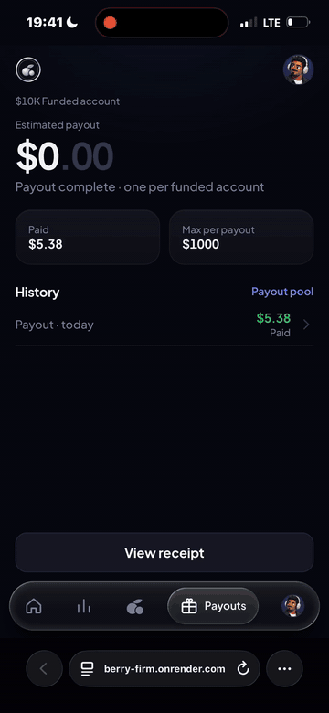
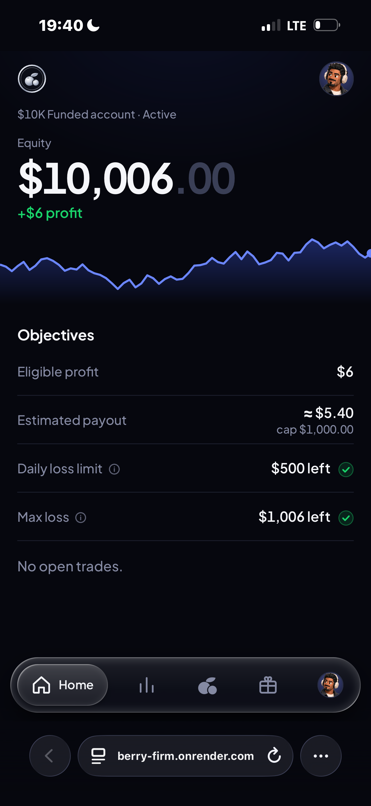
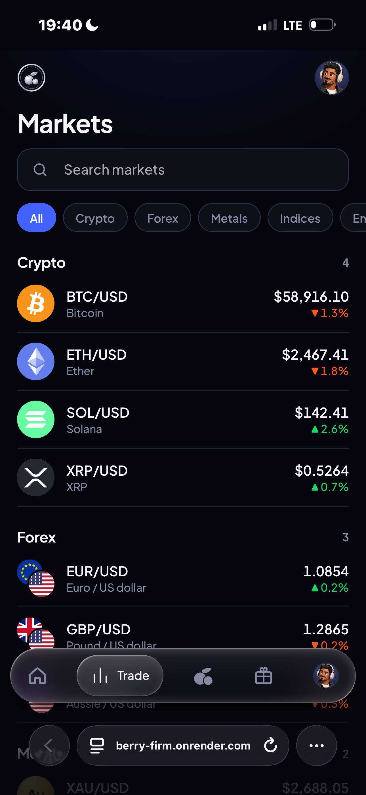
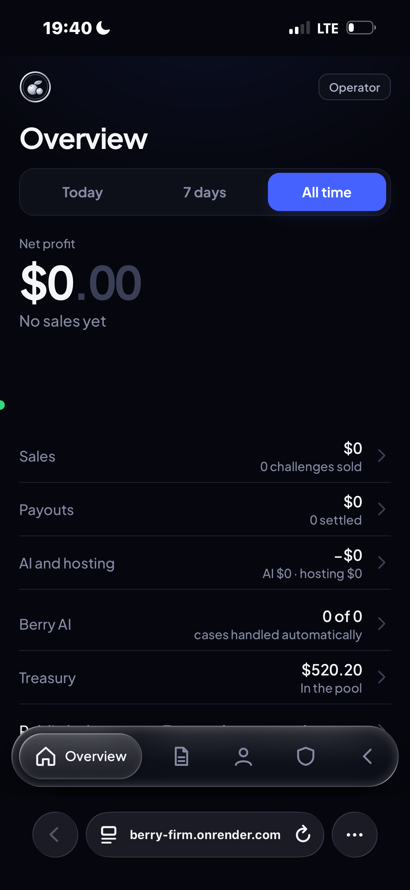
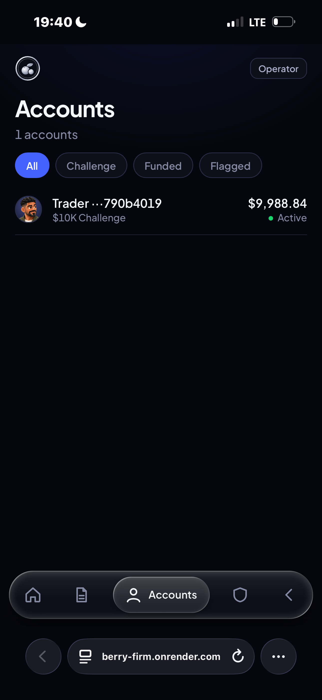
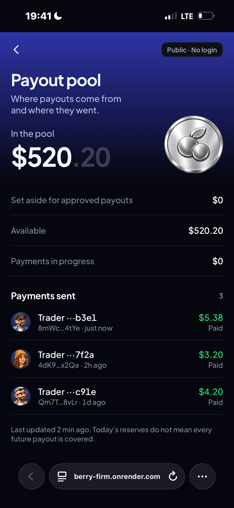
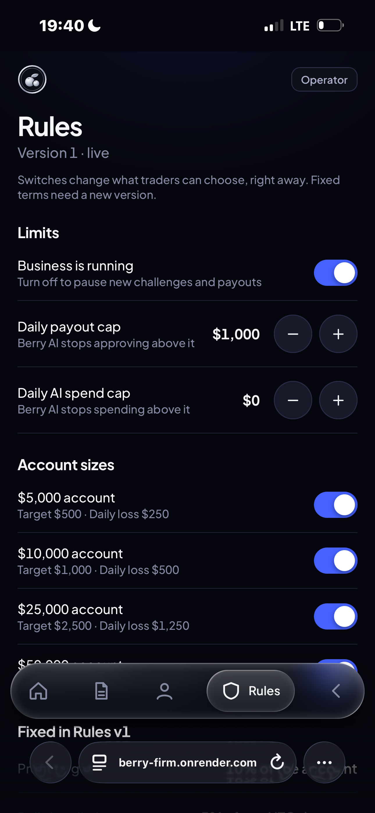
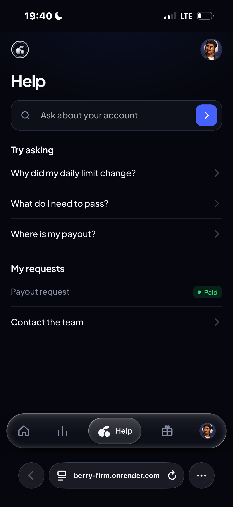

# Berry Firm

**Live judge demo:** [berry-firm.onrender.com](https://berry-firm.onrender.com) · Free test account, no payment required. Open **Profile → Run payout demo** to start the guided payout flow.

## The autonomous prop firm

Berry Firm turns the prop-firm operating model into autonomous capital infrastructure. A trader enters an evaluation, trades within clear risk rules, qualifies for funded capital, and requests a settlement. Berry AI evaluates the case; a policy gate enforces the owner's limits; the treasury executes only approved settlements; and the public ledger shows the operating record.

This is the prop-firm experience rebuilt as a company of one: no manual review desk for routine cases, no opaque settlement queue, and no agent access to treasury keys.

## Why it matters

The modern prop-firm model proves that traders will pay for access to a disciplined evaluation and capital-allocation pathway. Its bottleneck is operations: monitoring rules, reviewing payouts, protecting treasury liquidity, answering support questions, and keeping a credible audit trail.

Berry Firm makes that operating loop autonomous. The owner defines the commercial policy—risk limits, payout ceiling, treasury reserve, AI budget, enabled markets, and kill switch. The platform takes it from there.

## Product tour

The trader journey and owner console are designed to work well on a phone.

<p align="center"></p>
<p align="center"><sub>Short capture of the free demo flow. The payout shown is simulated; testnet settlements are verifiable from their NEAR transaction link.</sub></p>

<table>
  <tr>
    <td align="center"><a href="docs/screenshots/funded-account.png"></a><br><sub>Funded account</sub></td>
    <td align="center"><a href="docs/screenshots/markets.png"></a><br><sub>Markets</sub></td>
    <td align="center"><a href="docs/screenshots/operator-overview.png"></a><br><sub>Owner overview</sub></td>
    <td align="center"><a href="docs/screenshots/operator-accounts.png"></a><br><sub>Accounts</sub></td>
  </tr>
  <tr>
    <td align="center"><a href="docs/screenshots/payout-pool-demo.png"></a><br><sub>Payout pool · demo data</sub></td>
    <td align="center"><a href="docs/screenshots/operator-rules.png"></a><br><sub>Policy controls</sub></td>
    <td align="center"><a href="docs/screenshots/trader-help.png"></a><br><sub>Help and status</sub></td>
  </tr>
</table>

<p><sub>Demo balances are illustrative. Use the receipt’s NEAR testnet transaction link to verify a real settlement.</sub></p>

| Capability | Berry Firm |
| --- | --- |
| Evaluation engine | Deterministic, server-owned prices and replayable risk rules |
| AI operations | One constrained decision per payout: approve, reject, or escalate |
| Treasury | Policy-gated USDC settlement on NEAR testnet through an OutLayer custody wallet |
| Owner control | Live limits, spend caps, market availability, and a kill switch |
| Trust layer | Public ledger for revenue, AI costs, decisions, and settlements |

## The operating loop

1. A trader chooses an evaluation account and accepts Berry Rules.
2. The server owns pricing, fills, exposure, loss limits, and qualification status. The client never chooses the fill price.
3. A qualified trader starts a funded account and requests a settlement.
4. Berry AI reads the bounded case record and makes exactly one tool call: `approve_payout`, `reject_payout`, or `escalate`.
5. The policy gate independently verifies the payout ceiling, daily treasury cap, AI-spend cap, account status, wallet consistency, reserve, and kill switch; the settlement boundary then rechecks the on-chain wallet balance before a transfer.
6. The settlement rail executes only after those checks. Each decision and movement lands on the public ledger.

The evaluation market is a controlled environment, not an exchange or brokerage. That is what lets the platform reproduce every result and guarantee that the rules shown to a trader are the rules that determine the outcome.

## Product terms

Berry Firm is positioned as a one-step evaluation: a 10% target, 5% daily loss limit, 10% maximum loss, three qualifying trading days, and a 90% trader profit share. The initial commercial schedule is $59 for $5K, $89 for $10K, $199 for $25K, and $349 for $50K evaluation accounts; the policy starts with a $1,000 per-account and daily settlement ceiling, adjustable only by the operator.

The schedule describes the commercial product. By default, the local or hackathon demo (`RAIL=mock` or `RAIL=testnet`, `AUTH_MODE=demo`) gives judges free test access and collects no challenge payment.

Those are commercial product terms, not a claim that a faucet must hold matching real value. The testnet proof deliberately settles a small qualifying payout in test USDC; the rail refuses any amount that the testnet treasury does not actually hold.

## Run the platform

Node 24+ is required. There are no third-party runtime dependencies.

```sh
npm run build
npm start
```

Open [http://localhost:3000](http://localhost:3000). In the demo setup, the app signs into the configured demo account automatically. Open **Profile → Operator console** for owner tools; the public ledger is at `/#ledger` and policy controls are at `/#rules`.

## Deploy the judge demo to Render

The repository includes a Render Blueprint in `render.yaml`. It creates one Node.js web service with the NEAR testnet demo settings and a 1 GB persistent disk for the SQLite ledger. The service writes its database to `/var/data/berry.sqlite`; keep it to one instance while it uses SQLite.

1. In Render, choose **New → Blueprint**, connect `Bigestdave/berryfirm`, select the `main` branch, and use the repository's `render.yaml`.
2. When prompted, enter `AI_API_KEY` and `OUTLAYER_WALLET_KEY` from your local `.env` directly into Render's secret fields. Never add either key to GitHub or paste it into chat.
3. Review the paid web-service and persistent-disk charges in Render before creating the resources. A free web service has an ephemeral filesystem, so its SQLite ledger would be lost on restart or spin-down.
4. The live judge demo is [berry-firm.onrender.com](https://berry-firm.onrender.com). **Profile → Run payout demo** seeds a qualifying test case; the testnet treasury is shared with the local demo and is not replenished by **Reset run**.

NEAR Intents challenge checkout remains disabled in this demo. Evaluation access is free, trading uses the controlled simulation, and settlements use test USDC on NEAR testnet.

### Two-minute judge run

1. Start with `RAIL=testnet`, `AUTH_MODE=demo`, a funded OutLayer test-USDC treasury, and a working NEAR AI key if you want a model decision in the run.
2. Open **Profile → Reset run** to archive the previous demo account while keeping its ledger evidence.
3. Choose **Run payout demo**. Berry Firm seeds the qualifying funded account, creates the payout case, and opens its decision.
4. Review the model decision and independent policy result. Confirm only if approved; the OutLayer wallet then sends test USDC.
5. Open the public **Ledger** to see token usage and inference cost, the realized trader/treasury split, treasury balance before and after, and the NEAR testnet transaction link.

The payout remains at the final confirmation step until a person approves it. A reset archives the previous account and keeps its ledger records; it does not refill the on-chain treasury. Top up the test-USDC treasury before repeating a settled run. A reset is blocked while a payout is still pending. If the AI key is missing, Berry records a labelled policy fallback; if the provider errors, it escalates instead of pretending a model approved.

With `RAIL=testnet` and `AUTH_MODE=demo`, evaluation access is free: no challenge payment is collected or shown as revenue. The judge account is shared and resumes its state until reset.

## NEAR Intents challenge checkout

The optional paid checkout uses NEAR Intents 1Click on **mainnet**. The [current 1Click quickstart](https://docs.agentsonintents.com/integration/distribution-channels/1click-api/quickstart/introduction) says there is no testnet, so leave it disabled for the free testnet judge run. When enabled, a trader receives a quote for the published challenge fee, sends the exact quoted NEAR amount to the 1Click deposit address, and Berry Firm starts the evaluation only after 1Click reports `SUCCESS` (tokens delivered). A pending, failed, or refunded payment does not create an account or record a sale. The payment settles to the configured mainnet receiver; if the app is also running its testnet evaluation rail, the checkout and payout proofs are on different networks and are labeled separately.

Configure `NEAR_INTENTS_ENABLED=true` and a valid mainnet `NEAR_INTENTS_RECEIVER=your-mainnet-account.near` in `.env`. The checkout asks the buyer for a NEAR mainnet refund account. Keep this feature disabled until the receiver is correct and the operator is ready to accept mainnet funds. Without a partner key, 1Click currently charges an additional 25 bps on standard quotes; set `NEAR_INTENTS_API_KEY` if you have a partner key, as described in its [authentication guide](https://docs.agentsonintents.com/integration/distribution-channels/1click-api/authentication). The optional 1Click API integration is not exercised by the testnet payout demo.

## Activate the NEAR testnet treasury

Berry Firm includes an OutLayer-powered NEAR testnet rail. It sends six-decimal test USDC from an agent custody wallet using an NEP-141 `ft_transfer`; recipient token storage is registered before the transfer when required.

```sh
npm run wallet:testnet -- <your-existing-account.testnet>
```

The setup command creates a dedicated OutLayer testnet treasury wallet, writes the wallet credential and treasury account to `.env`, sets `RAIL=testnet`, and never prints the credential. It uses Circle's official NEAR Testnet USDC contract (`3e2210e1184b45b64c8a434c0a7e7b23cc04ea7eb7a6c3c32520d03d4afcb8af`). A newly generated implicit account may not yet exist on-chain, so fund native NEAR through OutLayer's funding page rather than sending directly from Meteor: use the URL printed by the setup command, select **Testnet**, choose **Direct transfer** (never Intents on testnet), and send 0.05–0.1 testnet NEAR for gas. Then prepare its USDC storage:

```sh
npm run wallet:testnet:status
npm run wallet:testnet:prepare
```

The status command is read-only: it confirms the generated treasury address and reports its native testnet NEAR and test-USDC balances without displaying its credential. The preparation command is the first action that can spend a small amount of free testnet NEAR on token storage, so run it only after the status check shows gas is available. You can then send or request test USDC to that treasury before running the app.

If a faucet UI rejects the generated 64-character treasury address, first claim native testnet NEAR to the named owner account (`berryfirm.testnet` in this setup). Open the OutLayer funding URL printed by the setup command, select **Testnet** and **Direct transfer**, and fund the treasury from that account; do not retry Meteor's normal transfer to an uncreated implicit account. Once the treasury has gas, run the preparation command and request the supported test-USDC asset to the treasury. This uses only free testnet assets.

Set the treasury policy in the OutLayer dashboard before demonstrating it: match the Berry daily cap, permit the USDC contract call and recipient-storage registration, and set an approval threshold only if you want to demonstrate an owner-held settlement. A policy-held request remains approved in Berry Firm and is never represented as settled until OutLayer returns a transaction hash.

Once funded, open **Profile → Run payout demo** to seed and review the case, or run `npm run seed:demo` before opening the app. The test journey qualifies a $0.89 profit and a $0.801 trader payout, so a $1 test-USDC treasury can complete one proof; it does not change the commercial product schedule or operator payout policy. A confirmed settlement exposes a **Verify on NEAR testnet** link directly in Berry Firm's public ledger. The seed route is available only with the explicit `AUTH_MODE=demo` testnet setup. Testnet assets have no cash value; mainnet settlement remains intentionally locked until this treasury path is fully exercised.

## AI decisioning and hard limits

Berry Firm is preconfigured for NEAR AI Cloud's OpenAI-compatible chat endpoint and the `z-ai/glm-5.3-flash` model. Create an API key in the [NEAR AI Cloud console](https://cloud.near.ai/), set a spend limit on the key, add `AI_API_KEY=<your-key>` to `.env`, and restart the server. Keep the key in `.env`; it is used by the server and never sent to the browser. GLM Flash supports tool use. Berry records provider-reported token counts and calculates usage cost at the [current published rates](https://near.ai/models/z-ai/glm-5.3-flash): $0.08 per million input tokens, $0.012 per million cached input tokens, and $0.50 per million output tokens. If a response omits usage, Berry logs a conservative estimate and marks it as estimated. In-flight calls reserve a byte-bounded maximum prompt cost plus the output limit against the daily AI cap before they are sent. Update the configured rates if you change models or NEAR AI changes its price list.

The model receives a bounded case summary and has no treasury key, payment credential, or direct rail access. It can call exactly one of three decisions. The deterministic policy gate remains the authority and independently checks the payout before settlement. The previously approved offline demo payout can be re-reviewed with Berry AI from its payout screen after the key is configured; that action does not send funds.

The policy gate in `server/store.mjs` remains the authority. It enforces:

- one payout per funded account;
- 90% of eligible profit, capped at $1,000 per funded account by default;
- daily payout cap and daily AI-spend cap;
- kill switch;
- no open positions;
- unchanged destination wallet; and
- treasury reserve before and immediately before settlement.

If AI configuration is missing, the walkthrough uses a deterministic policy decision labelled as such in its audit record. A provider error becomes an escalation; it does not silently switch to a model-less approval or move funds.

## Treasury rails

| Rail | Use | Settlement behaviour |
| --- | --- | --- |
| `mock` (default) | Local walkthrough | Creates an auditable demonstration settlement; no external transaction. |
| `testnet` | Hackathon proof | OutLayer-custodied test USDC transfer on NEAR testnet, with transaction hash. |
| `mainnet` | Future rollout | Locked. |

`SIGNER=outlayer` is the supported testnet signer. The server retains only the OutLayer `wk_` credential in `.env`; the agent never sees it. The custody key remains in OutLayer's TEE-backed wallet service.

## Environment

Copy `.env.example` to `.env` to customise a deployment. Do not commit `.env`, its OutLayer wallet credential, or the policy handoff URL.

Key settings:

```ini
RAIL=testnet
AUTH_MODE=demo
AI_BASE_URL=https://cloud-api.near.ai/v1
AI_API_KEY=your-key
AI_MODEL=z-ai/glm-5.3-flash
DEMO_WALLET=your-account.testnet
OWNER_ACCOUNT=your-account.testnet
USDC_CONTRACT=3e2210e1184b45b64c8a434c0a7e7b23cc04ea7eb7a6c3c32520d03d4afcb8af
OUTLAYER_API=https://testnet-api.outlayer.ai
```

Optional live challenge checkout:

```ini
NEAR_INTENTS_ENABLED=true
NEAR_INTENTS_RECEIVER=your-mainnet-account.near
NEAR_INTENTS_API_KEY=your-partner-key-if-available
NEAR_INTENTS_ORIGIN_ASSET=nep141:wrap.near
NEAR_INTENTS_USDC_ASSET=nep141:17208628f84f5d6ad33f0da3bbbeb27ffcb398eac501a31bd6ad2011e36133a1
```

`AUTH_MODE=demo` is deliberately scoped to the hackathon testnet journey. NEAR wallet-signature login is the next production authentication milestone.

## Verify

```sh
npm run build
npm test
```

The test suite covers the end-to-end local operating loop, daily payout-cap escalation, deterministic pricing/rules, and the OutLayer testnet request shape.

## Architecture

```
src/                 Trader experience, owner console, and public ledger
src/80-api.js        Browser adapter for persistent API state
server/rules.mjs     Deterministic evaluation pricing and rules
server/store.mjs     SQLite ledger, business state, and policy gate
server/agent.mjs     Constrained AI decision layer
server/intents.mjs  NEAR Intents 1Click payment quotes and status checks
server/rail.mjs      Treasury boundary: local walkthrough + OutLayer testnet
server/index.mjs     API and static application host
scripts/             Demo seed plus testnet-treasury setup and USDC preparation
test/                Business-loop, policy, and rail tests
```

## Roadmap to production capital

- NEAR wallet-signature authentication for traders and owners
- Mainnet USDC payout rail after testnet operational validation
- Verify NEAR AI response attestations and provider billing receipts
- Production deployment, monitoring, and recovery for pending 1Click payments

## Licence

MIT. See [LICENSE](LICENSE).
